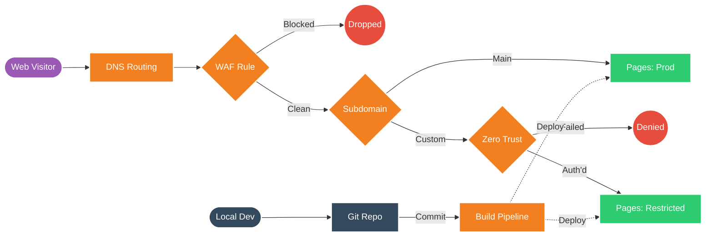

# Hi, I'm Geek Gelasia 👋

> code · curiosity · cosmic wonder · humanity · humor

Pronounced: `/gi:k/` ` /dʒɛˈleɪziə/`  
A poetic, ironic blend of modern intellectual enthusiasm and classical, lighthearted joy.

I build small digital things for large questions — digital sanctuaries and interactive art exploring the intersections of cosmology, neuroscience, biomechanic-electromagnetism, and philosophical wisdom.

## About Me

- 🧠 Profession: Creative Technologist (Cosmology & Philosophy)
- 🌌 Focus: contemplative curiosity, interactive art, poetic interfaces
- 🏗️ Core approach: dependency-lite builds, elegant frontends, meaningful experiences
- 📧 Email: [cosmicwonder@duck.com](mailto:cosmicwonder@duck.com)
- 🌐 Portfolio: [GeekGelasia.dev](https://geekgelasia.dev/)
- 🧵 GitLab: [GiikGelasia](https://gitlab.com/GiikGelasia)

## My Mission

I create digital spaces where wonder meets craft.

I believe the web can be more than utility — it can be a sanctuary for reflection, a tool for inquiry, and a medium for awe.

## Featured Work

### [cosmic-wonder](https://github.com/gi-k-glacier-0705/cosmic-wonder)
A living experiment in cosmic curiosity, designed as a digital sanctuary for thought, play, and exploration.

### [Orrery Chord](https://keplers-chord.geekgelasia.dev/)
A visual exploration of scale, motion, and perspective inspired by Kepler’s Laws of Planetary Motion.

### Interactive Artifacts
Digital demonstrations bridging classical philosophy — such as Epictetus’s *Enchiridion* — with modern web architecture and expressive interaction design.

> Coming soon.

## Toolkit

### Frontend
- HTML
- CSS
- JavaScript
- React
- Tailwind CSS

### Infrastructure
- Cloudflare Pages
- GitLab
- GitHub
- Zero Trust access patterns
- WAF configuration

### Creative Practice
- Zenga-inspired abstract aesthetics
- Sumi-e ink wash illustration
- Interactive audiovisual experimentation
- Minimal, contemplative design systems

## What I Build

- Small, thoughtful digital experiences
- Interactive explorations of science and philosophy
- Experiments in aesthetics, attention, and meaning
- Web interfaces that feel calm, poetic, and intelligent

## Current Focus

- Building contemplative digital experiences
- Exploring the interface between science, myth, and cognition
- Designing minimal but evocative web artifacts
- Learning deeper ways to blend artistry, systems thinking, and human meaning

## Connect

- 🌐 Portfolio: [GeekGelasia.dev](https://geekgelasia.dev/)
- 🐙 GitHub: [@gi-k-glacier-0705](https://github.com/gi-k-glacier-0705)
- 🧵 GitLab: [GiikGelasia](https://gitlab.com/GiikGelasia)
- ✉️ Email: [cosmicwonder@duck.com](mailto:cosmicwonder@duck.com)

---

---

If any of this confused you -> go read The Creative Act by Rick Rubin
